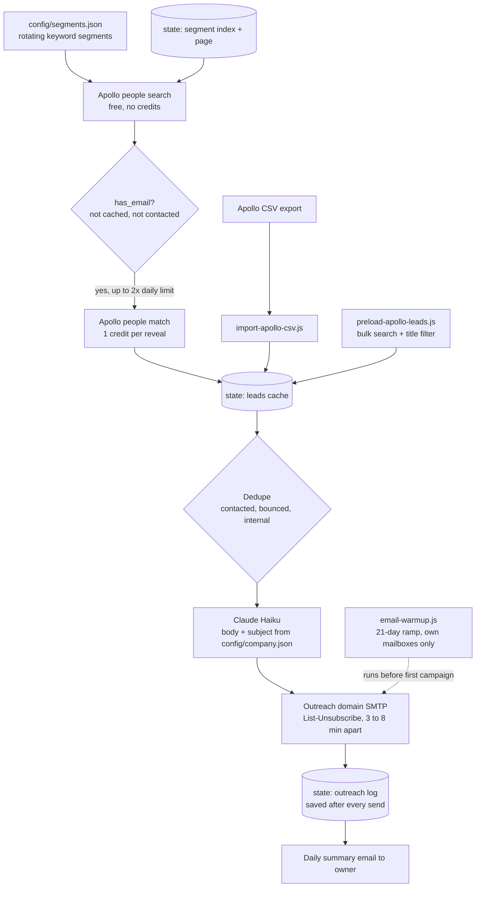

# Outbound Engine: daily cold outbound from Apollo search to sent email, with a credit cap and a warmup ramp

A scheduled pipeline that finds B2B prospects in Apollo, reveals an email only for the ones worth paying for, has Claude write a short personalized note for each, and sends them a few minutes apart from a dedicated outreach domain. A companion script ramps a new sending domain over 21 days before the first cold email goes out.

## The problem

A B2B wholesale business wanted to open new international accounts without a sales team. Doing outbound by hand means searching, copying emails, writing notes and tracking who has already been contacted, every day. Automating it carelessly creates three problems, and the design is built around them:

- **Credit burn.** Revealing an email costs an Apollo credit. Revealing every search result spends the allowance on people who will never be emailed.
- **Double contact.** Two runs in one day, or a crashed run that restarts, can email the same person twice.
- **Deliverability.** A new domain that sends 20 cold emails on day one is likely to land in spam.

## What it does

| Script | Schedule | What happens |
|---|---|---|
| `src/cold-email-outreach.js` | Weekdays | Picks today's segment, searches Apollo (free), reveals emails for people Apollo flags as having one (1 credit each, capped), drops anyone already contacted, bounced or internal, writes and sends up to 20 emails 3 to 8 minutes apart, then emails the owner a summary |
| `src/preload-apollo-leads.js` | Manual | Builds the lead cache in bulk before a campaign. Dry run shows counts and the maximum credit spend first. Applies a job-title filter |
| `src/import-apollo-csv.js` | Manual | Fallback for accounts without API access: imports Apollo CSV exports into the same cache, with column auto-detection and dedupe |
| `src/email-warmup.js` | Daily for 21 days | Ramps a new outreach domain from 5 to 20 emails a day between two mailboxes you own |

## Architecture



## Key design decisions

**Search is free, reveal is paid, so they are separate steps.** The search call returns people without emails and costs nothing. The reveal call costs one credit. The daily run only reveals people Apollo already flags `has_email`, skips anyone in the cache, and stops at twice the daily send limit. Leftover leads stay in the cache for the next day, so no reveal is wasted.

**Segments rotate and pagination resumes.** `config/segments.json` holds short keyword segments (Apollo AND-matches every term, so each is two or three words). The run stores a segment index and page number. It works through one segment's pages across several days, then moves to the next, so no search is repeated.

**State is written after every send.** The contacted list is saved as soon as each email goes out, not at the end of the run. A crash at email 12 cannot cause emails 1 to 11 to be sent again on the retry.

**Three dedupe gates before any send.** Already contacted, previously bounced, and internal domains (`internalDomains` in the company config). The gates run when leads are cached and again immediately before sending.

**Sends are staggered.** Emails go out 3 to 8 minutes apart with a daily cap of 20. The workflow accepts a lower limit as an input for the first days after warmup.

**Every email carries an opt-out.** A `List-Unsubscribe` header with one-click support, plus a plain "Reply STOP to opt out" line in the body.

**Dry run is a first-class mode.** `--dry-run` does the search, reveal and writing, prints each subject and a body preview, and sends nothing. The workflow exposes it as a checkbox.

**Copy lives in config, not in code.** The company description, offer lines, call to action, signature and banned words are read from `config/company.json` and injected into the prompt. Changing the pitch never means editing a script.

**Contact data never enters git.** The lead cache and outreach log live in `state/`, which is gitignored. In CI they are carried between runs by the Actions cache.

**Warmup uses only mailboxes you own.** The ramp sends from the outreach domain to your own second mailbox and replies back, 5 a day rising to 20 over 21 days. No third party receives warmup mail.

## What this repo does not do

Reply classification, bounce suppression from the inbox, and follow-up cadence run as separate jobs: see [ai-reply-triage](https://github.com/Michael-Wootan/ai-reply-triage) and [followup-sequencer](https://github.com/Michael-Wootan/followup-sequencer). This script only records a bounce when the SMTP server rejects the message at send time.

## Repository layout

```
src/cold-email-outreach.js    daily run: search, reveal, dedupe, write, send, summarize
src/preload-apollo-leads.js   bulk lead-cache builder with title filter and credit estimate
src/import-apollo-csv.js      CSV import fallback (no dependencies)
src/email-warmup.js           21-day domain warmup ramp
src/config.js                 env + config/*.json loader, internal-domain check
config/                       example company profile, segments and warmup conversations
.github/workflows/            weekday outreach run and daily warmup run
```

## Setup

Requires Node 20+, an Apollo API key, an Anthropic API key, an outreach mailbox with SMTP access, and a second mailbox for summaries and warmup replies.

```bash
npm install
cp .env.example .env                                         # fill in values
cp config/company.example.json config/company.json           # your company, offers, signature
cp config/segments.example.json config/segments.json         # your target segments
node src/preload-apollo-leads.js                             # dry run: counts and max credits
npm run dry-run                                              # writes emails, sends nothing
npm run warmup                                               # start the 21-day ramp
```

| Variable | Purpose |
|---|---|
| `APOLLO_API_KEY` | People search and email reveal. Optional if you only use CSV import |
| `ANTHROPIC_API_KEY`, `CLAUDE_MODEL` | Email body and subject |
| `OUTREACH_SMTP_HOST`, `OUTREACH_SMTP_PORT`, `OUTREACH_SMTP_USER`, `OUTREACH_SMTP_PASS`, `OUTREACH_FROM_EMAIL` | The outreach domain's mailbox |
| `SENDER_NAME` | Display name on outgoing mail. Defaults to `senderName` in the company config |
| `GMAIL_USER`, `GMAIL_APP_PASSWORD`, `EMAIL_NOTIFY` | Summary emails and the reply side of the warmup |
| `CONFIG_DIR`, `STATE_DIR` | Override the `config/` and `state/` locations |

In GitHub Actions, put keys and passwords in repository **secrets**. The workflow writes `config/company.json` and `config/segments.json` from the repository **variables** `COMPANY_JSON` and `SEGMENTS_JSON`, so real targeting never has to be committed.

Scheduled runs are off by default. Set the repository variable `ENABLE_SCHEDULE` to `true` to turn the schedule on; manual runs from the Actions tab always work.

---

Extracted from a production automation suite I built and ran for a live e-commerce and B2B wholesale business, 2026.

© Michael Wootan. Source shared for portfolio review; all rights reserved.
